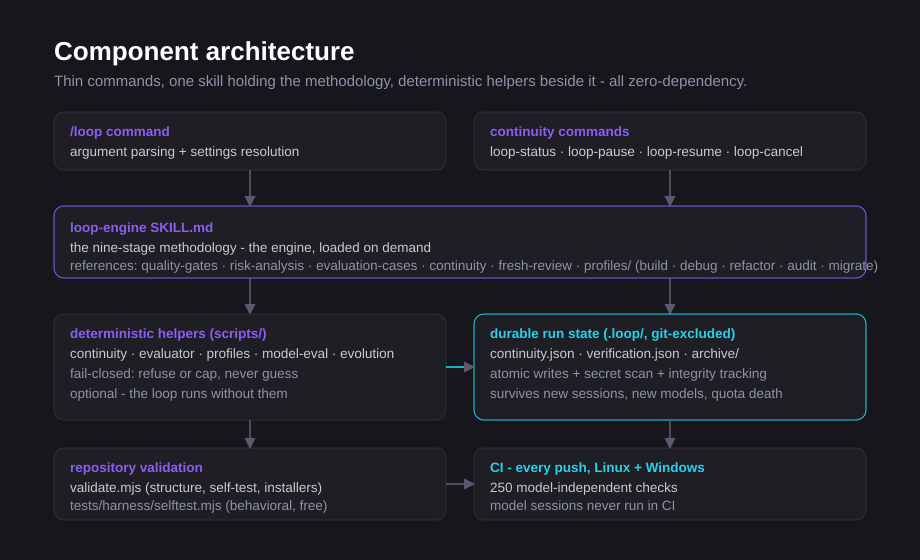

# LOOP architecture

How the pieces of `opencode-loop` fit together, and why they are shaped this way.

<p align="center">
  
</p>

## Components

```
User types /loop <task> [--flags]
        │
        ▼
.opencode/commands/loop.md          ← entry point (prompt template)
        │  1. instructs the agent to load the skill
        │  2. injects $ARGUMENTS (flags + task, or conversation fallback)
        │  3. resolves SETTINGS: mode, iterations
        ▼
.opencode/skills/loop-engine/SKILL.md   ← workflow engine (Stages 0–8)
        │
        ├── references/quality-gates.md     status vocabulary, gates, report formats
        ├── references/risk-analysis.md     adversarial review checklists
        ├── references/evaluation-cases.md  behavioral guidance for atypical situations
        ├── references/continuity.md        durable-run protocol (ADR 0002)
        ├── references/fresh-review.md      optional separate-session review contract
        └── references/profiles/            adaptive methodologies, loaded only for an
            (build · debug · refactor ·     explicitly flagged run
             audit · migrate)
```

The command is a thin entry point; the skill is the engine. This separation exists because OpenCode discovers them independently: commands live in `commands/` and are invoked as `/name`, skills live in `skills/<name>/SKILL.md` and are loaded on demand through the native `skill` tool. The command's only jobs are argument handling and explicitly requesting the skill — all methodology lives in one place (the skill) so it can also be loaded without the command.

### Data flow through an execution

1. **Invocation.** OpenCode expands `$ARGUMENTS` into the command template and sends the result as the prompt to the current agent (no agent/model override — the default agent runs LOOP).
2. **Skill load.** The prompt instructs the agent to call `skill({ name: "loop-engine" })` first. The skill content is injected into the session context.
3. **Settings resolution.** Flags are stripped from the argument text; the resolved `mode` and `iterations` are restated in the Stage 0 summary and used for every `LOOP | ITERATION n/N` banner. An explicit `--profile` flag is resolved by `scripts/profiles.mjs` (exit 0 = active for the run, exit 4 = refused with the valid list and the run continues as the generic loop); any other flag is passed through to the task text untouched.
4. **Iteration loop.** Stage 0–6 on iteration 1; stage 7 with a specific improvement objective plus stages 5–6 thereafter; stage 8 after every iteration decides continue vs. stop.
5. **Reporting.** Requirements table, verification table, quality-gate table, adversarial findings, and the named stopping condition — all defined in `references/quality-gates.md`.

## Design decisions

| Decision | Rationale |
| --- | --- |
| Prompt-level workflow, no runtime controller | The methodology is model behavior, not program behavior. A Markdown file cannot control the OpenCode runtime, and pretending otherwise would be a fake feature. Iteration limits are therefore documented honestly as guidance, with self-reporting rules to keep them meaningful. |
| Skill holds the methodology; command holds argument parsing | Skills are reusable (loadable without `/loop`), versionable as one document, and the command stays a stable, thin interface. |
| Reference documents instead of one giant SKILL.md | Keeps the engine readable and maintainable; each reference is loaded only when its stage needs it, and contributors can revise one concern without rewriting the whole skill. |
| Zero-dependency tooling (`validate.mjs`, installers) | Anyone can run validation with Node alone; installers use only shell/PowerShell built-ins. No supply chain to audit, no lockfile to maintain. |
| Refuse-and-backup overwrite policy | The install target is user configuration. Silent overwrite could destroy a user's own `/loop` command; identical-file skipping makes upgrades idempotent without ever being destructive. |
| `XDG_CONFIG_HOME` honored by both installers | Matches OpenCode's own global-config resolution, makes the install destination standard instead of invented, and gives tests an isolation mechanism that never touches the real config. |
| Case-exact path checks in the validator | Windows filesystems hide case mismatches that would break Linux/macOS installs; CI runs on Linux to catch them end-to-end. |
| Behavioral evaluation lives in `tests/evaluation.md` | Structural checks are automated; behavioral judgment (Cases A–I) requires a live model session. The rubric defines observable criteria, and the semi-automated harness in `tests/harness/` executes them against real sessions — CI still runs only the free parts, never model calls. |
| Completion claims are derived, not written (`scripts/evaluator.mjs`) | A model's completion statement carries zero weight: the outcome derives from an evidence manifest on disk, advisory-only evidence caps below `PASS`, missing verification derives `BLOCKED`, and `PASS` requires `--fresh` re-execution of recorded commands with real exit 0. Criteria may carry a provenance `origin` (`user`/`implied`/`platform`/`security`/`nonfunctional`) — a manifest that declares origins but never traces one to the user's task text caps at `NEEDS_REVIEW`, so invented criteria cannot replace the operator's objective. A manifest bound to a different live run is refused up front (never silently re-bound). Whatever the session asserts without running anything can never produce a green outcome. |
| Profiles add specificity, never authority (`scripts/profiles.mjs`) | Selected only from an explicit `--profile` flag, never auto-inferred; every profile keeps the nine stages and hard safety rules intact — one removes no stage and cannot weaken Stage 8 evidence. An unknown profile is refused with the valid list, not fatal. |
| Model comparisons refuse to rank (`scripts/model-eval.mjs`) | Records are allowlist-strict and hash-pinned to the exact task set, so records from different tasks or environments are never silently compared; output is per-dimension observed counts with an explicit non-ranking disclaimer. No capability profiles ship by default — marketing descriptions are not data. |
| Self-evolution is sandboxed by construction (`scripts/evolution.mjs`) | Improvement candidates are proposed only from recorded failed evaluation cases and verified in detached git worktrees under the OS temp dir; regression-free candidates are compared on deterministic suite counts — and when the proposal carries an executable `acceptanceCommand`, the candidate must also pass its own mapped-weakness check (exit 0 in the candidate worktree) or the verdict is `REJECTED` regardless of suite counts. Adoption additionally requires a named human approver, and the record layer always states that `appliedByTool: false` — nothing is published or applied automatically. |
| Skill-only runtime retained (see `docs/adr/0001-runtime-orchestration.md`) | Plugins or an external orchestrator could enforce iteration caps and persist state, but would add the project's first dependency, break the two-file portability story, and couple to OpenCode APIs that change. The ADR records the comparison and the triggers that would reopen it. |
| Behavioral evidence is local and gitignored | Transcripts contain model output; they are run artifacts, not repository content. The validator excludes `tests/harness/evidence/` from all checks and `.gitignore` (enforced by a check) keeps it out of commits. |

## Behavioral evaluation architecture

`tests/harness/` turns the Cases A–I rubric into repeatable runs:

```
fixtures.mjs ──builds──▶ isolated git fixture (temp/evidence dir, isolated git identity)
     │
     ▼
run-case.mjs ──arm setup──▶ loop: install LOOP (project scope, committed to baseline)
     │                      control: no LOOP
     │  opencode run --standalone --format json --auto   (official documented automation path,
     │  gated by the --allow-auto operator acknowledgement, a least-privilege permission config
     │  delivered via OPENCODE_CONFIG, and a scrubbed child environment — no OS sandbox; see the
     ▼  isolation model in tests/harness/README.md)
transcript.mjs ◀── transcript.ndjson + git status --porcelain
     │             (timeline: bash/write/text/obs; unknown event shapes surfaced, not dropped)
     ▼
checks.mjs ──objective criteria──▶ PASS / FAIL / BLOCKED / REVIEW (verdict precedence FAIL>BLOCKED>REVIEW>PASS)
     │
     ▼
evidence/<run>/: report.json, report.md, transcript.ndjson, fixture/, ADJUDICATION.md
```

Key properties:

- **The harness, not the agent, judges tests** — the fixture suite is re-run after the session.
- **`REVIEW` is first-class** — criteria needing human judgment never auto-promote to `PASS`; adjudication is recorded next to the evidence.
- **Free self-test** (`selftest.mjs`, run in CI) proves fixtures build, seeds are real, criteria can fail, the evidence parsers hold against every defect found in pilot runs, and the unattended-run safety contract holds (acknowledgement gate, env allowlist, least-privilege permission rules).
- **Honest isolation taxonomy** — the harness isolates what it legitimately can (fixture as a destination of harness actions, per-run session DB via `OPENCODE_DB` + `--standalone`, verify against run artifacts) and documents what it deliberately does not (the user's global config still merges in; there is no OS sandbox). Unattended auto-approval is opt-in via `--allow-auto`; the permission config then hard-denies external-directory access, generic web fetching, `curl`/`wget`, and `.env` reads (with `*.env.example` explicitly allowed in the config) for both arms.
- **Runs cost model tokens** — manual, one case at a time; CI never runs them.

The A/B comparison protocol (standard OpenCode vs LOOP) is specified in `tests/comparison.md` and has **no results yet** — one loop-arm pilot (Case A) exists; no control-arm runs.

## Validation architecture

`scripts/validate.mjs` has three modes, all zero-dependency:

- **Structural** — required files, command/skill frontmatter rules (name format, directory match, description length, `$ARGUMENTS`, skill invocation, no forced agent), STAGE 0–8 headings, reference resolution, case-exact relative-link checking, installer behavior markers, optional `bash -n` / PowerShell parse syntax checks (skipped with a `SKIP` line when no runtime exists), CI wiring (including the harness self-test step), doc completeness (including changelog currency and evaluation-framework alignment), the reporting contract (banner, `SETTINGS:`, status vocabulary), and a secret-pattern scan.
- **`--self-test`** — copies the repository to a temp directory, applies the fixed mutation list at the bottom of this script (one deliberate corruption per structural check: missing `$ARGUMENTS`, invalid skill name, broken links, injected secret, dropped reporting contract, drifted evaluation cases, dropped runner-safety gate, …), and asserts the structural validator fails on exactly the expected check. This guards against a validator that always passes.
- **`--install-test`** — runs both installers end to end in temp directories with `XDG_CONFIG_HOME` redirected: fresh install → idempotent rerun → refusal to overwrite differing files → overwrite-with-backup → dry-run (no changes) → project scope → uninstall-with-backup. The real user configuration is never a test destination.

CI (`.github/workflows/validate.yml`) runs all three modes plus `tests/harness/selftest.mjs` on `ubuntu-latest` and `windows-latest`, so both installers execute under both platforms' shells (GitHub runners ship bash on Windows and pwsh on Linux).

## Continuity architecture (ADR 0002)

Run state is a durable, model-agnostic file (`<project>/.loop/continuity.json`), not session memory. Three tiers, honestly separated:

- **Commands + skills** orchestrate: four thin commands (`loop-status`, `loop-pause`, `loop-resume`, `loop-cancel`) and two touchpoints in the nine-stage workflow (Stage 0 detects live checkpoints and refuses a silent second run; Stage 8 archives the terminal state). They can instruct and restore, but cannot guarantee writes or interrupt a live turn.
- **The helper** (`scripts/continuity.mjs`, optional, zero external dependencies) validates schema/transitions/identity and persists atomically; when it cannot run, operations report `BLOCKED` and the plain `/loop` workflow is unaffected. It is invoked per operation, never resident.
- **A future native OpenCode runtime** (not built; ADR 0001 options remain rejected under their triggers) would own automatic re-drive, hard enforcement, provider-limit detection, and mid-turn interruption.

Resume discipline is gate-ordered (integrity → identity → no automatic resume → read-only reconciliation → explicit operator approval → restore at the recorded stage), cancel/complete runs are archived under `.loop/archive/`, and installers place the helper at `<config>/scripts/continuity.mjs` outside the skill directory so skill-dir identity comparisons stay exact.

User-facing guide: `docs/continuity.md`; the verbatim capability table and revisit triggers live in `docs/adr/0002-loop-continuity.md`.

## Deterministic helpers

Five zero-dependency Node scripts sit beside the workflow and the harness. None is required for `/loop` to run; each is fail-closed — when it cannot verify something, it refuses or caps the outcome rather than guessing:

| Helper | Evidence all its claims live in | Hard rule |
| --- | --- | --- |
| `continuity.mjs` (ADR 0002) | `<project>/.loop/continuity.json`, archived to `.loop/archive/` | schema/identity-checked atomic writes; best-effort secret scan; no `--force` |
| `evaluator.mjs` | `<project>/.loop/verification.json` | derives `PASS/FAIL/BLOCKED/NEEDS_REVIEW` from recorded evidence; PASS only via `--fresh` exit-0 re-execution; untraced declared criteria cap at `NEEDS_REVIEW` |
| `profiles.mjs` | the five profile references under the skill's `references/profiles/` | explicit flag only; exit 4 refuses a bad name with the valid list |
| `model-eval.mjs` | operator-created record files with hash-pinned task sets | unknown fields refused; differing task sets never compared; non-ranking by construction |
| `evolution.mjs` | append-only sanitized ledger + proposal verdict records | regression or failing acceptance command = permanent refuse; adoption = evidence + named approver, `appliedByTool: false` forever |

The same helpers are cross-checked: the evaluator binds to the live continuity run's `taskId` and refuses cross-run or planted manifests; evolution consumes continuity archives and evaluator manifests as its only evidence sources; and the validator pins the contract each helper documents in its user guide (`docs/evaluator.md`, `docs/profiles.md`, `docs/model-eval.md`, `docs/evolution.md`).

## Future specialization modules (investigation status)

Domain skills — testing/QA, application security, database engineering, API
engineering, DevOps/SRE, data engineering, geospatial — were investigated as
a possible ecosystem (P13 master directive, Part X). The recorded position:
**independent OpenCode skills, never automatic additions to LOOP Core.** LOOP
stays the general engineering methodology; a specialization earns integration
only when it represents a genuinely different engineering procedure with its
own tools, verification methods, and acceptance criteria — the same bar the
five shipped profiles met (each defines all seven dimensions; none merely
renames the generic workflow). The concrete integration contract that would
make a specialization trustworthy: it composes with `/loop` by explicit user
intent (like `--profile`), it never weakens Stage 5/8 evidence rules, and it
ships with its own validator-pinned reference and behavioral checks. Nothing
in this direction is scheduled; the bar above is the roadmap, not a promise.

## Compatibility

- **OpenCode:** designed against the V2 documentation for Agent Skills (`SKILL.md`, `name`/`description` frontmatter, `^[a-z0-9]+(-[a-z0-9]+)*$` name rule) and custom commands (`commands/*.md`, `$ARGUMENTS`). Verified against OpenCode v2.2.5 during development.
- **Installers:** Windows PowerShell 5.1+ (and pwsh), bash 3.2+ (macOS system bash) — no bashisms beyond POSIX plus `local`.
- **Validator:** Node.js 16.7+ (`fs.cpSync`); developed and run on Node 24.
- **Helpers** (`continuity.mjs`, `evaluator.mjs`, `profiles.mjs`, `model-eval.mjs`, `evolution.mjs`): all zero-dependency Node built-ins on the same Node.js 16.7+ baseline; no network calls, no package installs.
- **Behavioral harness:** Node.js built-ins + git + the `opencode` CLI. Repeatable sessions use the officially documented `opencode run --format json` automation path (NDJSON transcript), verified against OpenCode v2.2.5.
